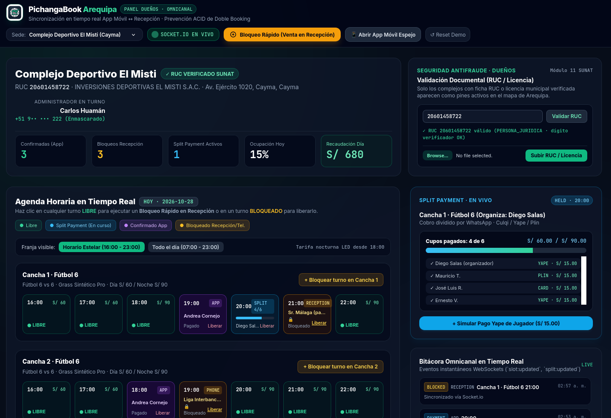
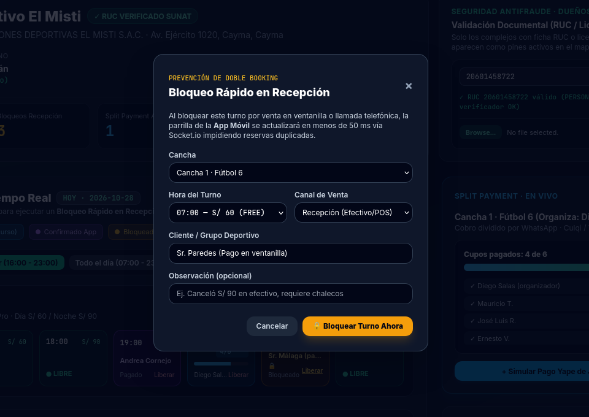
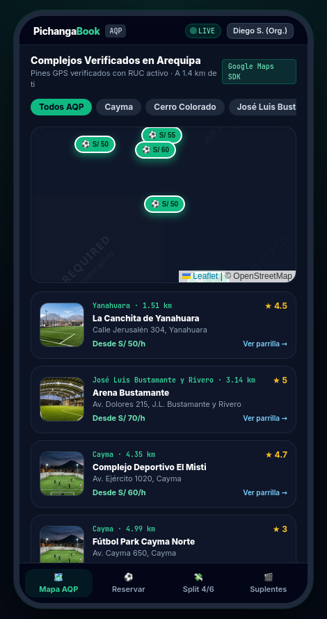
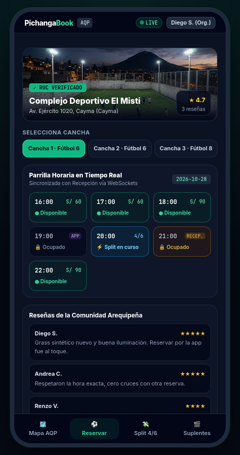
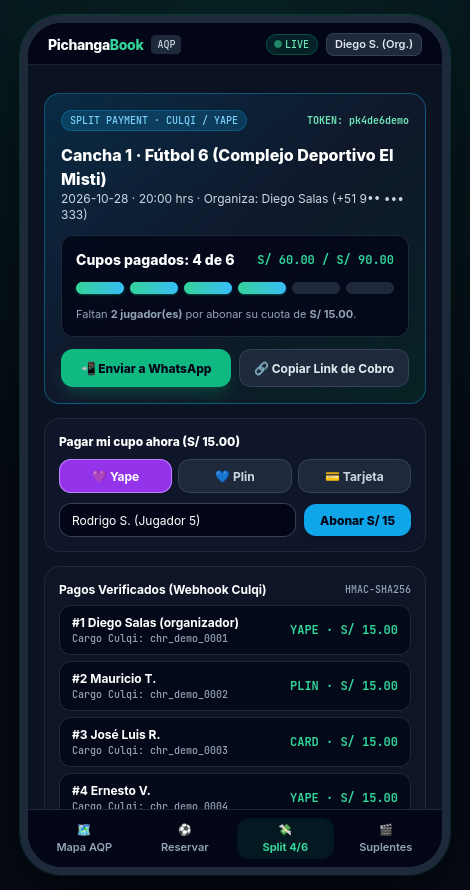
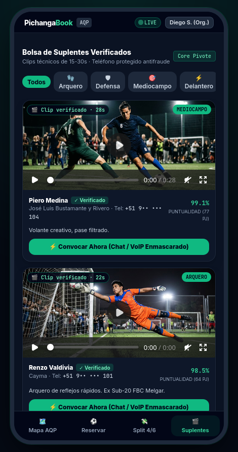
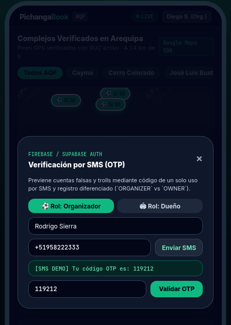
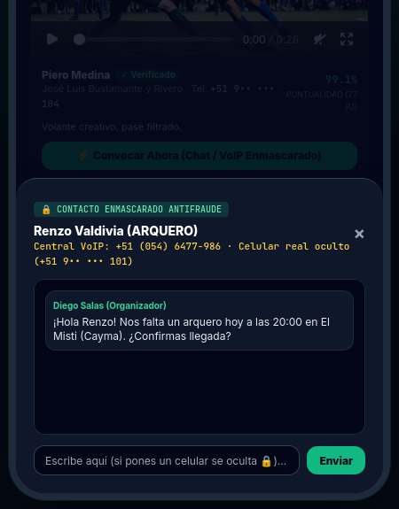

# Informe Técnico de Avance de Proyecto: PichangaBook Arequipa

**Universidad Católica San Pablo**  
Facultad de Ingeniería y Computación · Escuela Profesional de Ciencia de la Computación  
**Curso:** Formación de Empresas de Base Tecnológica I  
**Autores:** Rodrigo Sierra · Samuel Iman  
**Repositorio:** `https://github.com/RodrigoSierr/PichangaBook`  
**Fecha:** 28 de octubre de 2026  

---

## 1. Introducción y objetivo del avance

La organización de partidos amateurs de fútbol en canchas sintéticas de Arequipa enfrenta tres problemas operativos recurrentes que afectan tanto a los jugadores como a los propietarios de complejos deportivos. En primer lugar, la mayoría de establecimientos gestiona su agenda combinando cuadernos físicos en ventanilla con mensajes de WhatsApp, lo que ocasiona reservas duplicadas (*doble booking*) cuando dos grupos solicitan el mismo horario por canales distintos. En segundo lugar, el organizador del partido suele asumir el adelanto económico de toda la cancha y enfrenta cancelaciones o demoras cuando recolecta las cuotas individuales de sus compañeros. En tercer lugar, la ausencia de último minuto de un jugador clave —especialmente el arquero— provoca la suspensión del encuentro por falta de un mecanismo confiable para convocar reemplazos cercanos cuyo nivel técnico y puntualidad sean conocidos de antemano.

**PichangaBook Arequipa** aborda estas limitaciones mediante una plataforma que conecta en tiempo real la recepción del complejo deportivo con los dispositivos móviles de los jugadores y organizadores. El presente informe documenta el avance técnico del Producto Mínimo Viable (MVP), cuyo objetivo es demostrar la integración funcional entre las interfaces de usuario, el servidor de aplicaciones y el esquema relacional de base de datos, verificando que las operaciones críticas de reserva, bloqueo en recepción, cobro fraccionado y búsqueda de suplentes funcionen de extremo a extremo sobre código ejecutable.

---

## 2. Arquitectura general y tecnologías principales

El sistema está organizado como un repositorio unificado (*monorepo*) dividido en tres componentes claramente diferenciados que se comunican a través de servicios REST y canales persistentes de WebSockets:

El **panel web administrativo** (`/web-admin-tailwind`) está dirigido al personal de recepción y a los propietarios de los complejos deportivos. Fue construido con HTML5 semántico, hojas de estilo en Tailwind CSS y el cliente JavaScript de Socket.io. Su propósito es ofrecer una vista de escritorio rápida que permita supervisar la ocupación diaria, verificar el Registro Único de Contribuyentes (RUC) del establecimiento y bloquear horarios de forma inmediata cuando ingresa una venta presencial o telefónica.

La **aplicación móvil para jugadores y organizadores** (`/mobile-flutter`) fue estructurada en Flutter (Dart) siguiendo una división modular por pantallas (mapa de complejos, detalle de canchas, pagos divididos y bolsa de suplentes) junto con un servicio centralizado de comunicación (`RealtimeApiService`). Adicionalmente, para facilitar las pruebas sincronizadas en navegador junto al panel de recepción durante la exposición académica, se desarrolló una interfaz espejo interactiva (`demo-app-mobile.html`) conectada exactamente a los mismos controladores REST y eventos WebSocket del servidor.

El **núcleo backend y la capa de persistencia** (`/backend-nestjs`) se implementaron sobre Node.js utilizando el framework NestJS con TypeScript. El servidor expone la API REST bajo el prefijo `/api` e incorpora un gateway de comunicación bidireccional con Socket.io (`BookingsGateway`) que agrupa las conexiones por complejo y por cancha. La persistencia se apoya en PostgreSQL mediante un esquema relacional que delega la integridad de los turnos al propio motor de base de datos utilizando la extensión `btree_gist`. Para permitir la ejecución local inmediata sin depender de servicios externos activos, el módulo de base de datos soporta tanto una conexión estándar a PostgreSQL en Docker como una instancia embebida en memoria (PGlite WASM) que ejecuta íntegramente el archivo `schema.sql` y los datos de prueba de Arequipa (`seed.sql`).

---

## 3. Funcionalidades implementadas

### 3.1. Panel web administrativo para propietarios de complejos

Permite a los administradores de canchas sintéticas gestionar la ocupación diaria de todas sus canchas, supervisar el avance de reservas con cobro dividido y validar la documentación tributaria del local desde el navegador.

| Captura de la interfaz | Explicación técnica |
| :--- | :--- |
| <br>*Figura 2. Vista principal del panel web de administración mostrando el complejo El Misti (Cayma), su agenda horaria y el módulo de validación RUC.* | En esta vista el administrador consulta las métricas del día (reservas confirmadas por app, bloqueos de recepción, pagos divididos activos y recaudación), junto con la parrilla horaria por cancha y una bitácora de eventos en vivo. Fue construida en `web-admin-tailwind/index.html` con HTML5 y Tailwind CSS, consumiendo los endpoints `GET /api/complexes` y `GET /api/bookings/courts/:id/schedule` mientras mantiene una conexión activa con el cliente de Socket.io.<br><br>En el panel superior derecho se ubica el módulo de verificación documental. Al ingresar el RUC del establecimiento, `ComplexesController` aplica el algoritmo oficial de módulo 11 de SUNAT (en `src/common/utils/ruc.util.ts`) para comprobar el dígito verificador antes de actualizar el estado del complejo a `VERIFIED` en PostgreSQL. |

### 3.2. Bloqueo rápido en recepción y control de concurrencia

Facilita el registro inmediato de alquileres presenciales o telefónicos en ventanilla, bloqueando el turno al instante en la aplicación móvil para impedir reservas duplicadas sobre la misma hora.

| Explicación técnica | Captura de la interfaz |
| :--- | :--- |
| Cuando un grupo alquila una cancha en ventanilla o por teléfono, el recepcionista pulsa cualquier turno libre para abrir este formulario emergente, donde selecciona la cancha, el horario, el canal de venta y el nombre del cliente. Al confirmar, el navegador envía `POST /api/bookings/quick-block` hacia `BookingsService` en NestJS, registrando la operación dentro de una transacción SQL.<br><br>Para impedir que un usuario móvil reserve el mismo horario en paralelo, la tabla `bookings` utiliza la restricción GiST `bookings_no_overlap` sobre el intervalo `tstzrange(start_time, end_time, '[)')`. Si ocurre un cruce simultáneo, PostgreSQL aborta la segunda escritura con el código `23P01` (devuelto como `409 Conflict`) y, tras confirmar el bloqueo, `BookingsGateway` emite `slot.locked` por WebSockets a todos los dispositivos conectados. | <br>*Figura 3. Formulario emergente de bloqueo rápido en recepción ejecutado sobre la Cancha 1 del complejo deportivo.* |

### 3.3. Mapa de complejos deportivos y filtros por distritos de Arequipa

Permite a los jugadores localizar canchas sintéticas verificadas en Arequipa sobre un mapa interactivo, filtrar por distrito y comparar tarifas por hora junto con la distancia desde su ubicación.

| Captura de la interfaz | Explicación técnica |
| :--- | :--- |
| <br>*Figura 4. Vista móvil del mapa de Arequipa con pines de precios y tarjetas de complejos verificados.* | La pantalla inicial de la aplicación móvil muestra un mapa centrado en la ciudad de Arequipa donde cada complejo deportivo aparece representado por un marcador con su tarifa base por hora. En la parte superior, el usuario dispone de selectores rápidos para filtrar establecimientos ubicados en Cayma, Cerro Colorado, Yanahuara, José Luis Bustamante y Rivero o el Cercado, mientras que en la parte inferior se listan las tarjetas resumen con fotografía, dirección, calificación promedio y distancia en kilómetros.<br><br>En el código fuente móvil, esta vista está estructurada en Flutter dentro de `lib/screens/arequipa_map_screen.dart` (empleando el paquete `google_maps_flutter`) y cuenta con su contraparte ejecutable en navegador en `demo-app-mobile.html`, la cual utiliza Leaflet sobre cartografía de OpenStreetMap cuando no se dispone de una llave comercial activa de Google Maps en el entorno local.<br><br>Los datos provienen del endpoint `GET /api/complexes` gestionado por `ComplexesService`. La consulta SQL en PostgreSQL filtra exclusivamente los locales cuyo estado documental es `VERIFIED`, calcula el precio mínimo entre sus canchas activas y ordena los resultados aplicando la fórmula geodésica de Haversine en `MapsService` a partir de las coordenadas GPS de referencia del jugador en Arequipa (`-16.3989, -71.5350`). |

### 3.4. Disponibilidad horaria, reseñas y reserva de canchas

Muestra el detalle de cada cancha del complejo elegido, las reseñas de otros jugadores y la parrilla horaria sincronizada en tiempo real con la recepción del local.

| Explicación técnica | Captura de la interfaz |
| :--- | :--- |
| Al seleccionar un complejo desde el mapa, el jugador accede a la vista de detalle donde puede alternar entre las canchas disponibles del recinto (por ejemplo, canchas de Fútbol 6 o Fútbol 8), consultar la tarifa diurna y nocturna con iluminación LED, y revisar los comentarios registrados por otros organizadores de la comunidad local.<br><br>El componente central de esta vista es la parrilla horaria interactiva, programada en `lib/screens/court_detail_screen.dart` y sincronizada mediante `RealtimeApiService`. Al elegir una cancha, el cliente solicita al backend el estado de los bloques horarios del día (`GET /api/bookings/courts/:courtId/schedule`), diferenciando visualmente cuatro estados: turnos disponibles en color verde, reservas pagadas por aplicación, reservas retenidas bajo pago dividido (indicando el conteo de cuotas como `4/6`) y turnos bloqueados por recepción.<br><br>De manera simultánea, el cliente móvil se une a la sala de WebSockets correspondiente a la cancha (evento `join.court` en `BookingsGateway`). Esta conexión permite que cualquier cambio originado en la recepción del complejo o en el teléfono de otro organizador actualice la celda afectada al instante, evitando que el usuario inicie el proceso de pago sobre una hora que acaba de ocuparse. | <br>*Figura 5. Detalle del Complejo Deportivo El Misti con selección de cancha, estados horarios y reseñas.* |

### 3.5. Pagos divididos entre los integrantes de una pichanga

Permite fraccionar el costo del alquiler de la cancha en cuotas individuales, compartir el enlace de cobro por WhatsApp y confirmar la reserva automáticamente al completarse los pagos.

| Captura de la interfaz | Explicación técnica |
| :--- | :--- |
| <br>*Figura 6. Seguimiento en vivo del pago dividido (4 de 6 cupos abonados) e historial de cuotas verificadas.* | Para evitar que el organizador asuma la totalidad del adelanto, al seleccionar un horario libre puede elegir la modalidad de cobro dividido (*Split Payment*). La interfaz, definida en `lib/screens/split_payment_screen.dart`, presenta una barra de progreso con las cuotas cubiertas (por ejemplo, 4 de 6 cupos equivalentes a S/ 60.00 de S/ 90.00), un botón que genera un enlace directo hacia WhatsApp (`wa.me`) con el código de cobro y un formulario para registrar el abono individual mediante Yape, Plin o tarjeta.<br><br>En el servidor NestJS, la creación de una reserva bajo esta modalidad inserta el turno en estado `HELD` (retenido temporalmente) y genera un registro en la tabla `split_payments` asociado a un código único (como `pk4de6demo`). Cada vez que un integrante abona su cuota a través de `POST /api/bookings/split/:splitCode/pay-share`, el backend abre una transacción SQL y bloquea la fila mediante `SELECT ... FOR UPDATE` para impedir condiciones de carrera si dos jugadores pagan simultáneamente.<br><br>En el entorno actual del MVP, el servicio `CulqiService` simula la pasarela de pagos generando un identificador de transacción y validando una firma criptográfica HMAC-SHA256. Cuando el contador de cuotas pagadas iguala el total requerido, el backend cambia el estado de la reserva de `HELD` a `CONFIRMED` en PostgreSQL y notifica por WebSockets tanto a los jugadores como al panel del propietario. |

### 3.6. Bolsa de suplentes verificados con clips de video

Ofrece un directorio de jugadores disponibles para cubrir bajas de último minuto, incorporando filtros por posición, métricas de puntualidad y videos cortos de juego.

| Explicación técnica | Captura de la interfaz |
| :--- | :--- |
| La bolsa de suplentes constituye uno de los módulos diferenciadores del proyecto frente a la falta de jugadores minutos antes de iniciar un partido. Desde esta pestaña (implementada en `lib/screens/substitutes_pool_screen.dart`), el organizador puede filtrar perfiles por posición específica en el campo (arquero, defensa, mediocampo o delantero) y evaluar de forma objetiva a cada candidato antes de convocarlo.<br><br>Cada tarjeta presenta el nombre del jugador, su distrito en Arequipa, el porcentaje histórico de puntualidad junto al número de partidos asistidos y un reproductor de video integrado con un clip de entre 15 y 30 segundos que evidencia su desempeño real en cancha. La información se obtiene desde `GET /api/substitutes` a través de `SubstitutesService`, el cual realiza un `JOIN` en PostgreSQL entre las tablas `substitute_profiles` y `users` ordenando los resultados por disponibilidad y puntaje de cumplimiento.<br><br>A nivel de base de datos, el esquema exige mediante una restricción `CHECK (clip_duration_sec BETWEEN 15 AND 30)` que ningún clip exceda la duración permitida. Para la demostración local, los cuatro archivos de video en formato MP4 H.264 son servidos directamente por NestJS desde `/media/clips/`, mientras que `MediaService` implementa la estructura de firmas para su futura carga en Cloudinary o Amazon S3. | <br>*Figura 7. Directorio de suplentes mostrando filtros por posición, índice de puntualidad y reproductor de video de 15 a 30 segundos.* |

### 3.7. Autenticación por código SMS (OTP) y registro por roles

Valida la identidad del usuario mediante un código temporal enviado al teléfono móvil y distingue desde el registro las cuentas de organizadores y dueños de complejos.

| Captura de la interfaz | Explicación técnica |
| :--- | :--- |
| <br>*Figura 8. Ventana de autenticación por código SMS de un solo uso con selección de rol.* | Con el fin de reducir la creación de cuentas falsas que separen canchas sin intención de asistir, el flujo de acceso solicita al usuario elegir su rol (`ORGANIZER` o `OWNER`), registrar su nombre y vincular un número celular peruano en formato E.164 (`+519...`) para recibir un código numérico de verificación de seis dígitos.<br><br>Este proceso es gestionado en el backend por `AuthController` y `OtpService` mediante los endpoints `POST /api/auth/otp/request` y `POST /api/auth/otp/verify`. Al solicitar el código, el servidor almacena el desafío en la tabla `otp_challenges` de PostgreSQL con una ventana de expiración de cinco minutos y un límite de intentos fallidos. Al validarse el código correcto, el usuario queda marcado con `otp_verified = TRUE` y recibe un token de sesión firmado con HMAC-SHA256. En el entorno de demostración local, el código generado se muestra en pantalla para permitir la prueba inmediata sin depender de un proveedor de telefonía externo. |

### 3.8. Protección de números telefónicos y canal de contacto interno

Permite que el organizador convoque y se comunique con un suplente sin exponer el número de teléfono personal de ninguno de los dos usuarios.

| Explicación técnica | Captura de la interfaz |
| :--- | :--- |
| Publicar números celulares reales en un directorio abierto expondría a los jugadores y administradores a llamadas no deseadas o intentos de extorsión. Por ello, cuando el organizador pulsa el botón para convocar a un suplente, se abre un canal interno de mensajería y central telefónica simulada donde solo se visualiza una extensión intermedia y la versión enmascarada del teléfono (por ejemplo, `+51 9•• ••• 101`).<br><br>Esta protección se aplicó directamente en el diseño de la tabla `users` de PostgreSQL mediante una columna generada almacenada (`phone_masked TEXT GENERATED ALWAYS AS (...) STORED`), de modo que las consultas de la API nunca envían el campo `phone_e164` al navegador ni a la aplicación móvil.<br><br>Cuando se inicia la convocatoria mediante `POST /api/substitutes/:userId/recruit`, el backend crea una sesión temporal en la tabla `contact_relays`. Asimismo, cada mensaje enviado por `POST /api/auth/relay/:relayId/messages` pasa por un filtro de expresiones regulares en `AuthService` que detecta y oculta automáticamente cualquier secuencia de nueve dígitos antes de guardarla en `relay_messages`. | <br>*Figura 9. Canal de coordinación con suplente mostrando el número celular oculto y la central de contacto.* |

---

## 4. Pruebas realizadas y resultados

Para comprobar el funcionamiento real del backend, el esquema PostgreSQL y la sincronización por WebSockets, se programaron dos scripts automatizados de verificación dentro del directorio `backend-nestjs/scripts/`, los cuales se ejecutaron contra el servidor local en el puerto `3000`.

La primera prueba (`npm run test:realtime`, definida en `realtime-smoke-test.mjs`) evalúa el flujo funcional completo: verifica el estado del servidor y la conexión a la base de datos, comprueba el filtrado de complejos por distrito, valida el algoritmo módulo 11 de SUNAT sobre un RUC jurídico válido (`20601458722`), conecta un cliente WebSocket a la sala de la Cancha 1 de El Misti para medir la recepción del evento `slot.locked` tras un bloqueo en ventanilla, y ejecuta el pago de las dos cuotas restantes del código dividido `pk4de6demo` hasta confirmar que la reserva pasa automáticamente al estado `CONFIRMED`.

La segunda prueba (`npm run test:concurrency`, definida en `concurrency-test.mjs`) somete a prueba la prevención de reservas duplicadas. El script lanza ocho peticiones `POST /api/bookings` de forma simultánea mediante `Promise.all` apuntando exactamente a la misma cancha y al mismo intervalo horario (`16:00` a `17:00`), verificando que la restricción GiST `bookings_no_overlap` de PostgreSQL serialice el conflicto a nivel de base de datos sin permitir inserciones duplicadas.

| Prueba ejecutada | Aspecto técnico evaluado | Resultado obtenido |
| :--- | :--- | :--- |
| **Filtro geográfico y RUC** (`test:realtime`) | Consulta de complejos verificados en Cayma y comprobación del dígito verificador SUNAT (módulo 11). | 2 complejos devueltos en Cayma; RUC `20601458722` validado correctamente. |
| **Sincronización WebSocket** (`test:realtime`) | Emisión y recepción del evento `slot.locked` en el cliente móvil al ejecutar un bloqueo en recepción. | Evento recibido instantáneamente con estado `BLOCKED_RECEPTION`. |
| **Cierre de Split Payment** (`test:realtime`) | Procesamiento transaccional de los cupos 5/6 y 6/6 mediante bloqueo de fila `FOR UPDATE`. | Transición automática de la reserva de `HELD` a `CONFIRMED` al sexto pago. |
| **Estrés de concurrencia** (`test:concurrency`) | 8 solicitudes HTTP paralelas intentando reservar el mismo turno (16:00–17:00) en la misma cancha. | 1 solicitud aceptada (`201 Created`) y 7 rechazadas por PostgreSQL (`409 Conflict`). |

```sql
-- Restricción de exclusión en PostgreSQL (backend-nestjs/schema.sql) responsable de rechazar las 7 reservas paralelas:
CONSTRAINT bookings_no_overlap EXCLUDE USING gist (
  court_id WITH =,
  tstzrange(start_time, end_time, '[)') WITH &&
) WHERE (status IN ('HELD', 'CONFIRMED', 'BLOCKED_RECEPTION'))
```

---

## 5. Limitaciones actuales y próximos pasos

Si bien el prototipo presentado ejecuta de forma completa la lógica transaccional, el modelo de datos y la comunicación en tiempo real, es importante distinguir los componentes que operan actualmente mediante adaptadores locales de aquellos que requieren credenciales externas para su puesta en producción. Las integraciones con pasarelas de pago (Culqi para cobros con tarjeta, Yape y Plin), mensajería SMS para códigos OTP y almacenamiento en la nube para videos (Cloudinary / AWS S3) funcionan en esta entrega mediante servicios simulados dentro del backend (`CulqiService`, `OtpService` y `MediaService`), lo que permite validar la lógica de webhooks, firmas HMAC-SHA256 y cambios de estado sin realizar cargos bancarios reales; el siguiente paso consiste en conectar las llaves de prueba y producción de cada proveedor.

Asimismo, en el entorno de demostración local sin contenedor Docker externo, la base de datos se ejecuta sobre el motor PostgreSQL embebido en memoria (PGlite), reiniciando el estado a los datos semilla (`seed.sql`) cuando se reinicia el proceso del servidor. Para el despliegue en la nube se dejó preparado el archivo `docker-compose.yml` y el manifiesto `render.yaml` apuntando a una instancia persistente de PostgreSQL 16, además de contemplar la compilación del cliente Flutter en dispositivos físicos Android para las pruebas de campo con administradores de complejos en Cayma y Yanahuara.

---

## 6. Conclusiones

El desarrollo alcanzado en este avance demuestra la viabilidad técnica del Producto Mínimo Viable de PichangaBook Arequipa. Se logró articular en un mismo repositorio el panel web administrativo para propietarios, la interfaz móvil para jugadores y el backend modular en NestJS con PostgreSQL y Socket.io. Las pruebas ejecutadas confirman que el uso de restricciones de exclusión GiST en la base de datos resuelve de raíz el problema de las reservas duplicadas ante accesos concurrentes, mientras que la arquitectura orientada a eventos en tiempo real permite mantener sincronizada la ventanilla de recepción con los teléfonos de los organizadores durante el bloqueo de turnos y el cobro dividido de canchas.
